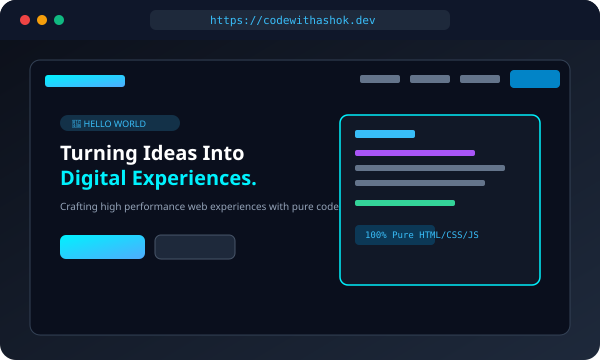

# Code With Ashok — Ashok Kumar Saini | Developer Portfolio Website

A premium, modern, responsive multi-page developer portfolio website built exclusively with **semantic HTML5, modern CSS3, and vanilla JavaScript** for developer **Ashok Kumar Saini**.



---

## 🌟 Key Features

- **Zero Framework Bloat**: 100% Pure HTML5, CSS3, and Vanilla JavaScript. No React, Vue, Angular, Bootstrap, or Tailwind CSS.
- **Multi-Page Architecture**:
  - `index.html` — Landing page with hero introduction, developer stats, featured projects, skills preview, and community invite.
  - `about.html` — Developer biography, educational background timeline, coding milestones, career goals, and downloadable resume.
  - `projects.html` — Interactive project showcase with real-time category filtering (Full Stack, Frontend, Python, C/C++), live search, and dynamic project count.
  - `skills.html` — Technical skills dashboard with categorized progress indicators (Frontend, Programming Languages, Tools, Best Practices) and learning roadmap.
  - `community.html` — Developer community hub with WhatsApp, Telegram, Instagram, and GitHub channel cards plus interactive FAQ accordion.
  - `contact.html` — Accessible contact form with real-time validation, character counter, direct `mailto:` draft generation, and headless webhook readiness.
- **Adaptive Dark / Light Theme**:
  - Deep Navy/Charcoal aesthetic with Electric Cyan & Indigo glowing accents.
  - One-click theme switcher in navigation with persistent `localStorage` preference.
- **Responsive & Accessible**:
  - Mobile-first CSS Grid and Flexbox layouts.
  - Animated mobile hamburger menu and drawer with touch overlay.
  - Accessible ARIA attributes, semantic headings, and keyboard navigation.
- **SEO & Performance Ready**:
  - Dedicated Open Graph & Twitter Card metadata on every page.
  - Structured Data (JSON-LD) for Person, CollectionPage, and Organization.
  - `robots.txt` and `sitemap.xml` included.
  - Sharp, vector SVG graphics that load instantaneously without external CDN dependencies.

---

## 📁 Project Folder Structure

```
Code-With-Ashok/
│
├── index.html                  # Home page
├── about.html                  # About Me & Journey
├── projects.html               # Dedicated Projects Showcase
├── skills.html                 # Technical Skills Dashboard
├── community.html              # Developer Community Hub
├── contact.html                # Contact Information & Form
│
├── css/
│   └── style.css               # Master stylesheet (variables, components, responsive rules)
│
├── js/
│   ├── main.js                 # Theme toggle, mobile drawer, scroll animations, counters
│   ├── projects.js             # Projects repository, filtering, and live search
│   └── contact.js              # Client-side form validation & email draft dispatcher
│
├── assets/
│   ├── images/                 # Responsive SVG mockups & developer avatar
│   ├── icons/                  # SVG icons
│   ├── fonts/                  # Web font references
│   └── resume-ashok.pdf        # Developer resume (downloadable)
│
├── favicon.svg                 # Scalable brand vector favicon
├── favicon.ico                 # Legacy browser favicon
├── robots.txt                  # Search engine crawler directives
├── sitemap.xml                 # XML sitemap for SEO indexation
└── README.md                   # Documentation & setup guide
```

---

## 🚀 How to Run Locally

Because this project relies strictly on vanilla web standards, no compilation, bundling, or `npm install` is needed!

### Method 1: Direct File Launch
Double click `index.html` in your file explorer to open it in any modern browser (Chrome, Edge, Firefox, Safari).

### Method 2: VS Code Live Server (Recommended)
1. Open the project folder in **Visual Studio Code**.
2. Install the **Live Server** extension (by Ritwick Dey).
3. Right-click `index.html` and choose **"Open with Live Server"**.
4. The website will load at `http://127.0.0.1:5500/index.html` with instant live reload on file edits.

### Method 3: Python Built-In Server
If Python is installed on your computer, run:
```bash
python -m http.server 8000
```
Open [http://localhost:8000](http://localhost:8000) in your browser.

---

## 🌐 Deployment & Hosting Guide

This static website can be hosted for **free** on any static hosting platform:

### 1. GitHub Pages (Free & Instant)
1. Repository: [`CodeWithAshokk/CodeWithAshokk`](https://github.com/CodeWithAshokk/CodeWithAshokk)
2. Push your project files to the `main` branch:
   ```bash
   git init
   git add .
   git commit -m "Initial release of Code With Ashok portfolio"
   git branch -M main
   git remote add origin https://github.com/CodeWithAshokk/CodeWithAshokk.git
   git push -u origin main
   ```
3. Go to **Settings > Pages** on your GitHub repository.
4. Under **Branch**, select `main` and root `/`, then click **Save**.
5. Your site will be live at `https://codewithashokk.github.io/CodeWithAshokk/` within 60 seconds!

### 2. Netlify / Vercel / Cloudflare Pages
- Drag and drop the project folder directly into the Netlify Drop dashboard, or link your GitHub repository. No build command is required (`Publish directory: .`).

---

## ✏️ Customization Guide

### 1. Personal Information & Bio
- Open `about.html` and `index.html` to customize your name, college, location, and bio paragraphs.
- Replace `assets/resume-ashok.pdf` with your actual updated resume file.

### 2. Adding / Editing Projects
Open `js/projects.js` and edit the `PROJECTS_DATA` array:
```javascript
{
  id: 'my-new-project',
  title: 'Project Title',
  category: 'fullstack', // 'fullstack' | 'frontend' | 'python' | 'cpp'
  badge: 'Full Stack',
  description: 'A brief description of your project...',
  image: 'assets/images/your-screenshot.svg',
  technologies: ['HTML5', 'CSS3', 'JavaScript'],
  liveDemoUrl: 'https://demo-url.com',
  githubUrl: 'https://github.com/CodeWithAshokk/repo-name',
  featured: true // set true to display on index.html
}
```

### 3. Updating Skill Percentages
Open `skills.html` or `index.html` and edit the percentage text and `data-width` attribute:
```html
<span class="skill-percentage">90%</span>
<div class="progress-track">
  <div class="progress-bar-fill" data-width="90%"></div>
</div>
```

### 4. Updating Community Links
Open `community.html` and replace the placeholder invite links for WhatsApp, Telegram, Instagram, and YouTube with your official channel URLs.

### 5. Connecting a Headless Form Backend (Optional)
The contact form currently validates inputs and opens a pre-formatted email draft using `mailto:`.
If you want emails delivered directly to your inbox without opening an email client:
1. Sign up for free at [Formspree](https://formspree.io) or [EmailJS](https://www.emailjs.com).
2. In `contact.html`, set the form action:
   ```html
   <form id="contact-form" action="https://formspree.io/f/YOUR_FORM_ID" method="POST">
   ```
3. In `js/contact.js`, uncomment or adapt the `fetch()` submission block.

---

## 📄 License & Attribution

Designed and developed for **Code With Ashok** by **Ashok Kumar Saini**.
© 2026 Code With Ashok — Ashok Kumar Saini. All Rights Reserved.
Distributed under the MIT License.
